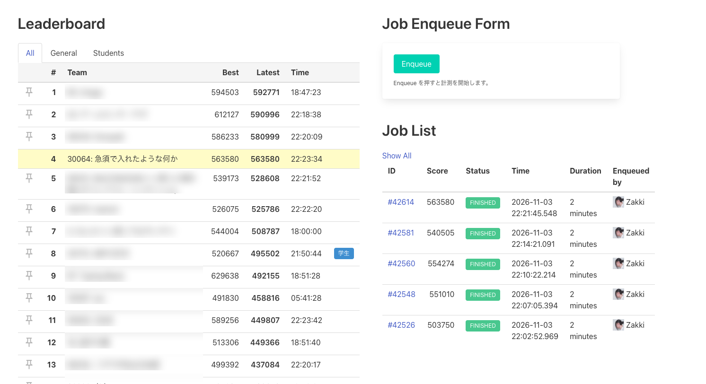
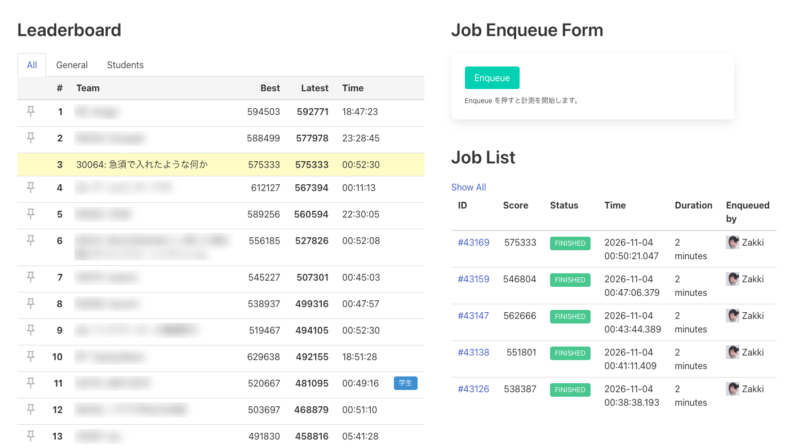

ISUCON2026 に同期 3 人で出て、856 チーム中 94 位でした。1 位の方は、競技中に人間が一度も指示を入れなかったそうです。

これを再現したくて、競技が終わったあとも Claude と一緒にハーネスを作り直し、過去問で試し続けました。ちょうど感想戦がオープンしたので試したところ、3 回目の試行で、僕から改善の方向を指示せずに開始 1 時間半で 51 万点まで届き、最高は 575,333 点でした。

この記事は、結果を見て僕が何を考え、ハーネスをどう変えていったかの記録です。

## 本番は 658 PR をマージして 94 位

本番の様子は同期の参加記に詳しく書かれています。

https://blog.usuyuki.net/isucon2026

| | |
|---|---|
| 順位 | 856 チーム中 94 位 |
| 最終スコア | 145,523 |
| 当日の最高 | 150,508 |
| マージした PR | 658 |
| 実装のエージェント | Codex 最大 20 並列 |

issue の起票、実装の割り振り、計測、デプロイとベンチ、監視と、エージェントの役割を細かく分けて動かしました。多いときは 1 時間に 111 件の PR をマージしていて、変更を入れる速さに問題はありませんでした。

それでも、後半は 12 万点あたりで止まりました。

## 1 位は人間の介入なしだった

1 位の Kawasaki さんの記事です。

https://zenn.dev/luvtechno/articles/isucon2026-competition-day

Claude Code の 1 セッションで、競技中の人間からの入力は 0 回でした。開始 35 分で方針を固め、開始 1 時間 22 分で 50 万点を超え、最終スコアは 625,857 点です。

## ハーネスの軌跡

ここからは時系列で書きます。ハーネスのリポジトリは `isucon-kit` です。試行の途中までは、デプロイやベンチの道具を別のリポジトリに分けていました。今は `isucon-kit` にまとめています。「T+0:27」は開始から 27 分後を指します。

### 11/01 「なんでこんなに場当たり的なんだろう」

競技の翌日、当日のエージェントのログを読ませて、最初にこう聞きました。

> これなんでこんなに場当たり的なんだろう。どうすれば根本的に改善できただろうか

答えは、変更を入れる仕組みはあったのに、何を変えるかを決める仕組みがなかった、というものでした。スコアの式、ピーク時に必要な CPU、利用者の行動の連鎖をすべて把握しているエージェントはいませんでした。どれも分かったのは競技の後です。

そこで新しいリポジトリを作ってもらいました。これが `isucon-kit` です。

初版を見て足りないと思ったのは、アプリの理解です。今回の問題は、1 日の同じタイミングで全員に通知が届き、時間内に写真を投稿するアプリです。瞬間的な投稿に耐える必要があるし、最初に投稿した人には友人の投稿がまだ見えません。平均の負荷を見ていても分からないし、普通の Instagram のようなアプリを想像して作ると負荷に耐えられません。どういう条件で次の日の利用者が増えるかも、理解していませんでした。

これをそのまま伝えて、kit を次のように変えました。

- アプリの特性（いつ、何をきっかけに、一斉に動くか）を書く文書と skill を足した
- ボトルネックを一時的に外して、スコアがどう動くかを見る実験の skill を足した
- ISUCON のチューニングの手引きを出典つきで 16 章書かせた

同じ夜に、Anthropic の記事「[When to fold subagents into your main agent loop](https://claude.com/ja/resources/articles/building-agents-when-to-fold-subagents-into-your-main-agent-loop)」を読みました。モデルが進化した今は、安易にマルチエージェントにするより、単一のループと skill のほうが速くて品質も高い、という内容です。本番の体制はこの記事が問題にしている形そのものでした。そこで役割分担をやめて、1 つのメインエージェントに設計、実装、デプロイ、ベンチをすべて担当させました。

### 11/02 未明 ISUCON9 本戦: 124,567 点から 471,143 点

実際に試さないと分からないので、ISUCON9 本戦を解かせました。結果は 4 時間で 124,567 点です。僕が以前同じ環境で取った 20 万点にも届きません。

途中で 3 つのことに気づきました。

1 つ目は、エージェントが本番では見られないベンチの詳細ログを読んでいたことです。これでは、ボトルネックを探す練習になりません。練習環境では本番で見えるものだけを見せる決まりを作り、確認の手順も足しました。

2 つ目は、スコアを上げる視点が抜けていたことです。失格の原因探しと、失格を避ける判断に時間を使っていました。20 万点取れる環境だと伝え、曖昧検索の精度のような加点の条件を指摘すると、ようやくスコアを上げる作業に移りました。

3 つ目は既存のコードを前提にしすぎていたことです。3,275 回の操作のうち、仕様書を開いたのは 3 回だけでした。

ここで 1 つ仮説を立てました。初期実装のコードの構造はスコアに響くはずで、アプリの仕様とリクエストの特性が分かった時点で作り直したほうがよいのではないか、というものです。その場で作り直させると、15 分で最初のベンチが通り、最終的に 471,143 点まで伸びました。

この結果を受けて、kit を次のように変えました。

- 仕様をマニュアルから先に書き出す手順を足した（基準は初期実装ではなく仕様にした）
- スコアのモデルに、取れなかった点の集計と、加点と減点を分けて数えることを足した
- こちらで選べる値（予約可能な日数など）を洗い出す節を足した
- 仕様から作り直すことを、構成の判断の正式な選択肢にした
- 作り直す判断の前に、設計を変える問いに答えさせる節を足した
- 届くスコアの目安を渡すことにした（後で撤回します）

最後の目安については、当時から「目標の点って最初から分かるわけじゃないから難しい」と話していました。

### 11/02 昼 ISUCON14: 456,220 点と、0 から考えさせること

次は ISUCON14 です。Claude Code で高いスコアを出した公開事例があったので、ベンチのサーバーの性能を上げずに 80 万点を目指させました。結果の最高は 456,220 点でした。

エージェントは、ベンチのサーバーがメモリ不足で止まるのを環境の制約とみなして、処理をわざと遅くする施策に 2 時間使いました。実際の原因はアプリ側で、マッチされずに待ち続ける利用者の接続がベンチにたまっていました。

見ていて気になったのは、初期実装の構成をそのまま引き継いでいることです。そこで次のことを伝えました。

> 使うプロトコルも、HTTP の種類も、DB もインフラ構成も、何から何まで全部 0 ベースでアプリケーション特性と制約から考えさせたほうがいい気がする。

TLS の暗号化方式や決済サーバーも含めて考えさせるべきだ、とも伝えました。そのあと試行を打ち切り、kit を直してからやり直しました。

kit の変更は次のとおりです。

- 制約の表と、0 から考え直す表を設計文書に足した
- ベンチや外部サービスが限界に見えたら、その負荷をアプリがどれだけ作っているかを数える、という指針を足した
- パラメータの調整に時間の上限を付けた

やり直した 2 回目は T+0:32 に作り直しを決めて、T+2:00 に 654,641 点まで届きました。0 から考える手順の効果が出ました。

一方で、60 万点台で 1 時間 15 分止まりました。必要な指針は kit に書いてあったのに、エージェントは自分から使いませんでした。そこで「スコアが 30 分更新されなければ数え直す」を足しましたが、同じ問題はこの後も出てきます。

また、後で調べると、80 万点は条件の違う感想戦の値で、ベンチのサーバーも小さすぎました。これは僕たちの準備の問題です。

### 11/02 夜 ISUCON13: 635,611 点

次の ISUCON13 では、ベンチの性能不足を先に解消してから始めました。目安の点も人間の本番の点ではなく、AI で解いた公開事例のスコアにしました。練習するのは AI だからです。

結果は追試で 635,611 点でした。公開事例の 705,235 点の 9 割に届いています。大きなミスはサーバーの CPU を平均で見て、張り付きを 45 分見落としたことでした。kit には CPU を秒ごとの最大で見ることを足しました。

ここまでは、失敗を見つけて決まりを足すやり方で進めていました。

### 11/03 未明 感想戦 1 回目: 78,780 点

感想戦のサーバーが用意されたので、本番の問題で試しました。4 時間の予定を途中で 8 時間に延ばして、最終は 78,780 点、追試は 84,501 点です。過去問とはまるで違う結果でした。

見ていて気になったことが 2 つあります。

1 つ目は作り直しです。T+0:41 に「データがメモリに載らない、時間が足りない」と作り直しを却下したまま、時間を 8 時間に延ばしても判断を見直していませんでした。最初は見直しの時刻を早めるよう言いましたが、考え直して次のように伝えました。

> 裁定のタイミングは時間ではなく情報量で実施すべき

2 つ目はやり取りの多さです。人間役（別の Claude のセッション）に約 40 回メッセージを送り、報告の返事を待って止まりかけました。依頼文に「判断は依頼元に聞く」と書いていたので、書いたとおりに動いた結果です。終わったあと、次のように伝えました。

> 完全に人間やこちらに質問することなく全部自分でやってほしい。ベンチも最初から自分でやってほしい

kit の変更は次のとおりです。

- 人間にも人間役にも質問、承認の依頼、判断の依頼をしない
- 区切りの報告は記録に書くだけで、返事を待たない
- ベンチは最初の 1 回から自分で流す
- 構成の判断は時刻で区切らず、情報が揃ったときに行う。前提が変わったらその場で判断し直す

### 11/03 昼 感想戦 2 回目: 263,447 点と、足し続けた結果

次に 1 位の記事を読みました。開始してすぐにメモリに載せる構成へ切り替えていて、判断が早いと感じました。署名を前もって計算する施策も、ハック的な発想ですごいと思いました。

Claude に「ハーネスとしてどうすべきか」を聞き、提案をそのまま kit に入れてもう一度走らせました。入れたのは、制約から設計の骨格を先に書く手順、「作り直しを既定にする」決まり、区切りで監査を促す hook とチェック項目、最終ベンチを止める基準を計算する道具です。

スコアは 263,447 点まで伸びて、1 回目の 3 倍以上になりました。ただ、動きを見ていると、気になることが次々に出てきました。

開始 30 分で、メモリに載せる案を「作り込みと整合の危険が大きい」と却下していました。これには次のように言いました。

> ISUCON だから、こんなこと言ってたらだめじゃないかな。通るまで直せばいいだけじゃない？

自分で書いた撤回の条件が満たされても、判断し直しませんでした。原因はドキュメントが多すぎて、判断に必要な数字が 5〜6 個のファイルに散っていたことだと考えました。ファイルを増やすのはやめて、自動で読み込まれる `AGENTS.md` と skill に手順を置き、ドキュメントは 3 つにまとめました。

作り直しも、ベンチ 1 回分のスコアの比較でやめていました。実際にはボトルネックが別の場所へ移っただけで、作業は進んでいました。原因の 1 つは、僕たちが渡していたスコアの目安だと考えました。そこで目安を渡すのをやめて、スコアを目標にせず徹底的にボトルネックをなくす方針に変えました。ただし、利用者の増え方や 1 人あたりのスコアのように、どうすればスコアが伸びるかは理解させます。

指摘の入れ方も試しました。答えを言わずに方向の誤りだけを伝えると、3 分で判断が変わりました。指摘は計 3 回入れています。

メインエージェント自身の振り返りには、次の一文がありました。

> 2 時間半、数字を見ていて読んでいなかった。

### 11/03 夕方 方針の転換: 足すのをやめて、考え方を書く

ここまで、Claude は失敗のたびに決まりと道具を足す案を出し、僕もそれを受け入れてきました。ただ、計測を道具で強制する案が出たときに、これは違うと思いました。

> 道具を与えてあげるとか、縛る方向よりも考え方の最適化ができたほうがいいと思う

1 位の差分を足す案にはこう伝えました。

> この課題に過適合するようなハーネスにするつもりはない。

もう一度 1 位の記事を読むと、目に留まった箇所がありました。「アクセスログから利用者の動きを読み始めました」という文と、その直後に方針を 3 つ固めている流れです。見るものを見て、どうすべきかを論理立てて決めているように読めました。2 回目のエージェントが利用者ごとの動きを読み始めたのは T+3:37 でした。

kit の変更は次のとおりです。

- 考え方を 8 項目にまとめ、`AGENTS.md` の先頭に置いた
- 構成の判断を「見たもの → 考え → 決めたこと」の 3 段で書かせるようにした
- メインエージェントの skill を 150 行から 65 行に減らした
- 監査の hook とチェック項目を標準から外した
- 問題に固有の例と解法をテンプレートからすべて外した
- 文書の中の造語を、読めば分かる言葉に直した

視点を柔軟に変えられるように、別の立場から見る問いも足しました。8 項目はこれです（短くしています）。

```markdown
1. **まず見る。** 利用者が何を見て、何をして、次に何をするかをログで読む。
2. **何がスコアを生むかを説明する。** 説明できない部分を次に調べる。
3. **理屈で形を決める。** 「これを見た → だからこう考える → だからこうする」とつなげて書く。
4. **速くする前に、無くせないかを考える。**
5. **視点を変える。** 利用者・1 つのリクエスト・データ・サーバー・採点・前提・別のチームから見る。
6. **施策の大きさで選ぶ。** 当たったら何倍になるかを先に見積もる。
7. **施策を入れたら、狙ったボトルネックが消えたかと、次に何が見えたかを見る。** スコアの目標は持たない。
8. **「十分」「危険」「大変」で止まらない。** 止まるのはマニュアルの禁止に当たるときだけ。
```

### 足して、後で外したもの

振り返ると、足して後で外したものが多くありました。

| 足したもの | 足した理由 | 今の扱い |
|---|---|---|
| 届くスコアの目安を渡す | 守りに入っていた | 外した。目安との比で判断するようになった |
| 構成の判断は人間が 12:00 に行う | 人間が責任を持つ | エージェントが、理屈がつながったときに行う |
| 区切りごとの報告 | 様子が見える | 記録に書くだけにした。返事を待って止まった |
| 4 つの設計文書（のちに表と節が増える） | 先に考えさせる | 1 つにまとめた。項目を埋める作業になっていた |
| 指針を増やす | 失敗を繰り返さない | 8 項目にまとめた。増やしても自分からは使わなかった |
| hook と監査のチェック項目 | 指針を自分から使わないので、時間で促す | 標準から外した。項目を照らし合わせても判断は変わらなかった |
| 解法に近い例（データをファイルに置く、など） | 1 位との差を埋める | すべて外した。過適合だった |

残ったのは、エージェントを 1 つにすること、人間に聞かないこと、ベンチを自分で流すこと、本番で見えるものだけを見せること、そして考え方です。

## 3 回目: 自分でメモリに載せる構成を選んだ

新しいサーバーと新しいリポジトリで、3 回目を始めました。前の記録は読ませていません。

| | 1 回目 | 2 回目 | 3 回目 |
|---|---|---|---|
| T+1:30 のスコア | 41,289 | 60,457 | **510,209** |
| 最後のスコア | 78,780 | 263,447（打ち切り） | **558,895**（最高は 575,333） |
| メモリから読む形に決めた時刻 | よく読むデータだけ T+2:33 | キャッシュとして T+1:56 | **T+0:27** |
| 方向についての外からの指摘 | あり（人間役との往復 約 40 回） | 3 回 | **T+4:35 に 1 回**（それまで 0 回） |

3 回目のエージェントは開始 7 分で利用者の動きを読むツールを自分で作りました。そして T+0:27 に次のように判断しました（`docs/DECISIONS.md` の要約です）。

> **見たもの:** 利用者は前の応答から 2ms で次のリクエストを出す。ログインと Memories を回し続ける利用者がいて、回数に上限がない。欧米は 1 クエリごとに 100ms かかり、CPU は 99% 空いている。
>
> **考え:** スコアは周回の数で決まり、周回は応答が速いほど増える。ボトルネックは CPU ではなく、DB までの往復と署名の計算。インデックスやキャッシュでは欧米の 100ms は消えない。
>
> **決めたこと:** 全サーバーが全データのメタデータをメモリに持つ形に作り直す。

この判断の前に、僕は指摘を入れていません。テンプレートにも、メモリに載せるよう指示する文はありません。

| ベンチの終了 | スコア | やったこと |
|---|---|---|
| T+0:05 | 3,556 | ベースライン |
| T+0:13 | 6,315 | インデックスの追加、署名の再利用 |
| T+0:42 | 192,422 | メモリ版（直前の FAIL 3 回を自分で直した） |
| T+0:47 | 339,740 | 署名の事前計算テーブル、`mlock`、GC の調整 |
| T+0:52 | 345,288 | nginx を外して Go で直接受ける |
| T+1:00 | 464,212 | セッションを全体のロックから外す、画像の配置の見直し |
| 約 T+1:23 | 478,457 | asia2 にも接続を振り分ける（4 台構成） |
| 約 T+1:29 | 510,209 | 通知をサーバーごとに一定の速さで送る実験 |
| 約 T+1:37 | 516,962 | 上の実験に、asia のログインの制限を追加 |
| 約 T+1:59 | 554,274 | 通知とログインの制限の調整を続ける実験 |
| T+2:10 | 563,580 | 操作の順序が逆転する不具合を直す、通知とログインの制限を調整 |
| 約 T+3:35 | 568,822 | ログインの制限を緩める（僕が最高点の更新を頼んだ後） |
| 約 T+4:39 | 575,333 | export と大きな JSON を 1 回で書く（僕の問いかけの後） |
| T+5:01 | 558,895 | 同じ版で 6 本流した最後の走行 |

開始 2 時間 10 分の時点で、ポータルの順位表は 4 位でした。順位表の Latest には感想戦のベンチも含まれるので、本番の順位とは比べられません。



575,333 点を出した時点では、Latest の順で 3 位でした。



署名の事前計算と nginx を外す施策は 1 位と同じで、どちらも自分の計測の数字から入れています。通知の実験は、1 位の「通知をずらす」に近い発想です。この実験では、5 日目の asia の人数が 1,382 人から 866 人に減ったのにスコアは上がりました。同じ設定は 1 回しか試していないので、効果はまだ言えません。

## 分かったこと

失敗のたびに決まりを足しても、エージェントは自分から使いませんでした。それが一番はっきり出たのが 2 回目です。短い考え方を常に読ませて手順を減らした 3 回目のほうが、早い段階で大きな判断をしました。ただし、これは 1 回の結果です。

1 位の施策をそのまま書き足しても、問題が変われば意味がありません。足すなら、なぜ自分で見つけられなかったのかを、問題に依らない形で書きます。

2 回目と 3 回目の一番の差は利用者の動きを読み始めた時刻（T+3:37 と T+0:07）でした。何を見るかがその後の判断を決めていたように見えます。

並列の数は本質ではありません。本番の 20 並列と 658 PR は何を変えるかが決まらなければスコアになりませんでした。

## これから詰めたいこと

3 回目で、55 万点前後までは安定して出せるようになりました。最後の変更の前の 2 つの設定で流した 10 本は、平均が約 55.3 万点、標準偏差が約 1 万点、最高が 568,822 点です。2 つの設定の違いはログインの制限の値だけです。

ただ、60 万点には届いていません。60 万点は平均より約 4.7 万点上で、ぶれの 4 倍以上離れています。開始 2 時間ごろから流した 42 本でも、最高は 575,333 点で、一度も届いていません。ベンチや実行環境のぶれを考えても、足りない値です。

比べる相手は、1 位の 62 万点ではなく平均です。1 位も同じ構成の 12 本が 474,987〜629,638 点に散らばり、最後の 5 本の平均は約 57.3 万点でした。記事に残る平均は、固定の遅延で約 59.3 万点、速い回だけを集めたレートを見る形で約 60.5 万点です。僕たちとは平均で 2〜5 万点の差があります。本番と感想戦のベンチが同じ条件かは確かめられていません。ただ、山の毎秒リクエスト数は僕たちが約 9,700、1 位が T+1:22 の時点で 9,757 で、大きな違いは見えません。

足りないものは 2 つあると感じています。

1 つ目は詰め切るためのチューニングとノウハウです。3 回目は T+2:10 に 563,580 点を出した後、設定の調整を続けました。最高点は 568,822 点まで上がりましたが、伸びはぶれの範囲に収まります。大きな施策で 50 万点台に乗せるところまでは、ハーネスでできるようになりました。そこからあと 5 万点を積む方法は、まだハーネスの中にありません。

2 つ目はそれをエージェントに実行させきるためのチューニングです。3 回目のエージェントは T+1:23 に、ボトルネックが自分のサーバーの外に移ったと記録しました。全体で約 450MB/s、約 9k req/s で頭打ちになる、という記録です。1 位のエージェントもベンチマーカー側の処理能力が上限だと判断しているので、ここまでは同じです。

違いはその先です。1 位は、その処理能力を何に使わせるかを試し続けました。通知をリージョンごとに 2.5 秒ずらし、asia の Memories の応答を遅らせて europe と america に回しています。スコアが 30 分伸びなければ、hook で監査役を起動して判断を見直させてもいます。3 回目のエージェントも通知とログインの速さは調整しましたが、T+2:54 に「最終形」と書きました。凍結まで 4 時間以上残っている時点です。そこから T+4:34 までのアプリのコードの変更は、追加 19 行と削除 9 行だけです。時間が残っている間は次の手を探し続ける、というところまで、エージェントを持っていけていません。

最後に僕が「ベンチやルーター側の負荷を軽くしてあげる処理をこちらからアプローチできない？」と聞きました。エージェントは export の応答が 125 個の chunk に分かれていると報告し、全部溜めて 1 回で書く形に直しました。大きな JSON も chunked をやめています。直後のベンチは 575,333 点で、この試行の最高でした。同じ版でさらに 6 本流すと 536,627〜574,924 点で、7 本の平均は約 55.8 万点です。その前の設定の平均との差はぶれの範囲で、効果があったとは言えません。予定は 8 時間でしたが、T+5:01 の走行で終わりにしました。最後のスコアは 558,895 点です。効果は別として、上限は相手側だと書いていたエージェントが、相手の負担をコードから減らす手を聞かれてから見つけたのは、まだ自分で探しきれていない証拠だと思います。

## コード

3 回目の試行の記録は公開しました。当日マニュアルと初期実装は外してあるので、読むためのリポジトリです。

https://github.com/Marie673/practice-isucon2026c

ハーネスは整理してから公開します。

- https://github.com/Marie673/isucon-kit（今はまだ非公開です）

## おわりに

同期は本番の反省として、戦略を人間に頼りすぎたと書いていました。僕も同じです。人間が戦略を持ってエージェントを並べる形だと、人間の理解が上限になります。

今回の試行で僕がやったことは、手順を足すことではなく、考え方を直すことでした。ハーネスのコードと、この記事の下書きは Claude Code が書いています。

最後に、ISUCON を運営してくださった皆さん、ありがとうございました。感想戦を開いてくださったおかげで、ここまで試すことができました。記事やポッドキャストで知見を共有してくださった Kawasaki さん、参加記や解説を公開してくださった皆さんにも感謝します。ハーネスに入れたチューニングの手引きは、皆さんの記事をもとに作りました。そして、一緒に出てくれた同期にも感謝です。

