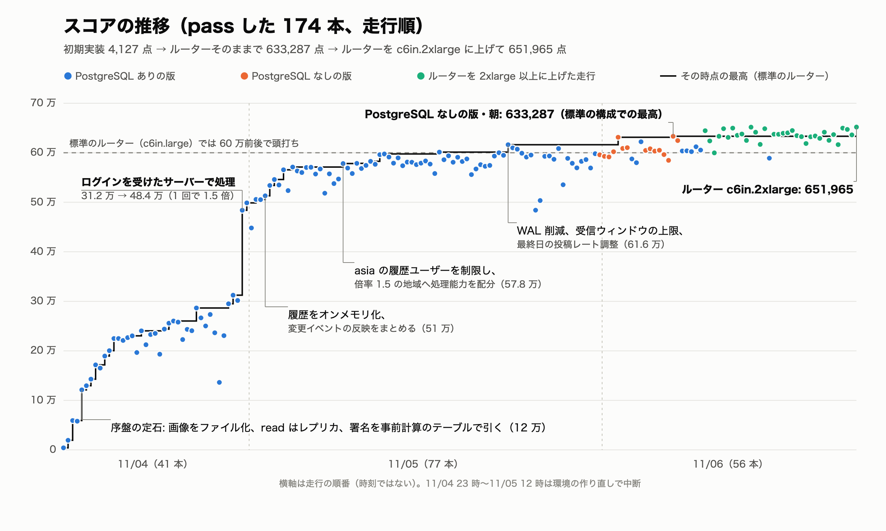
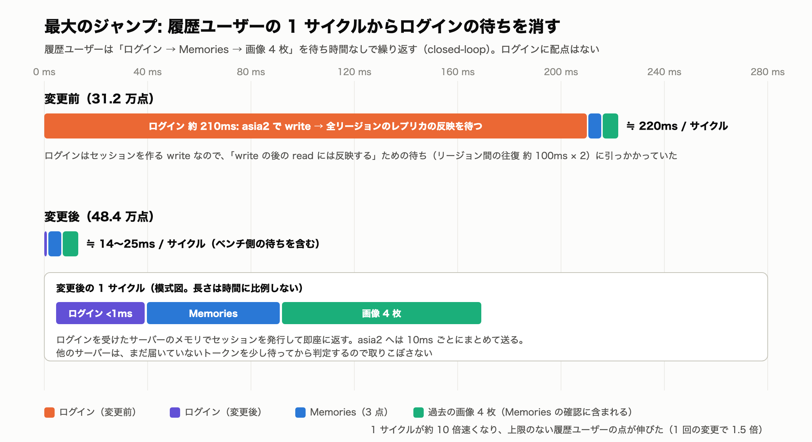
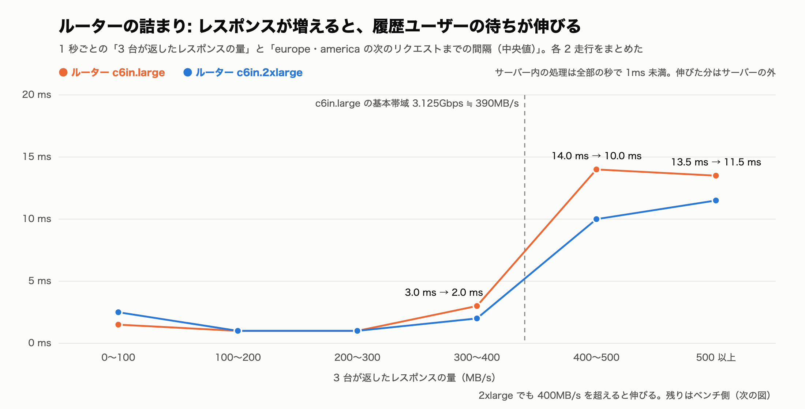
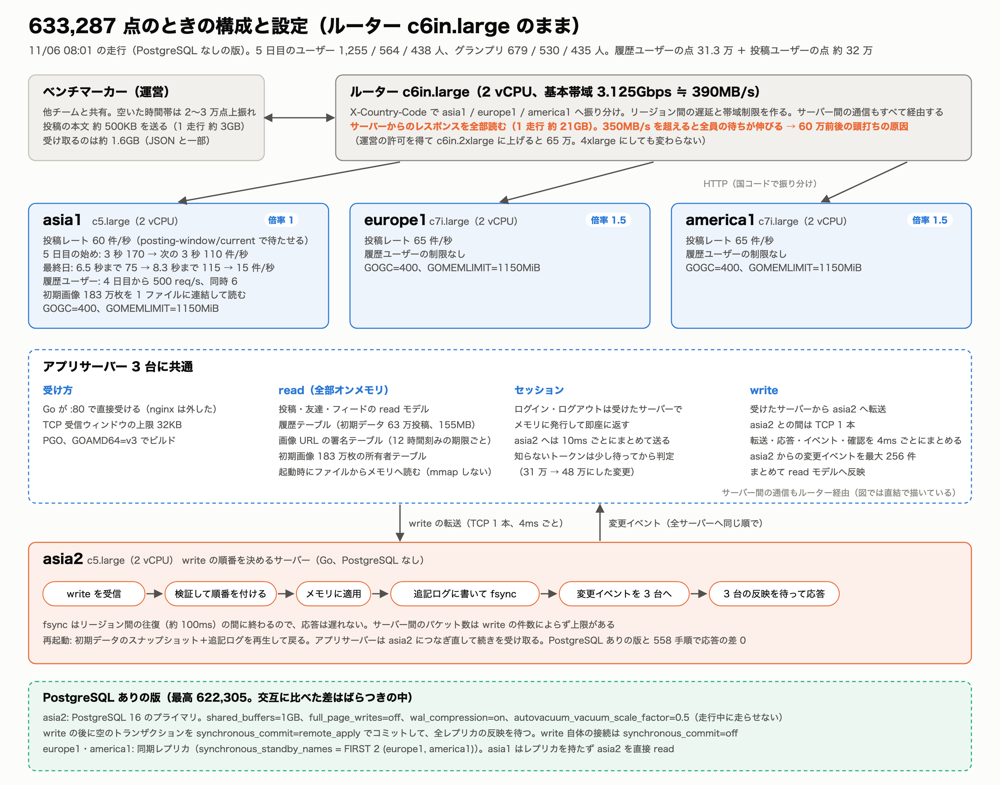
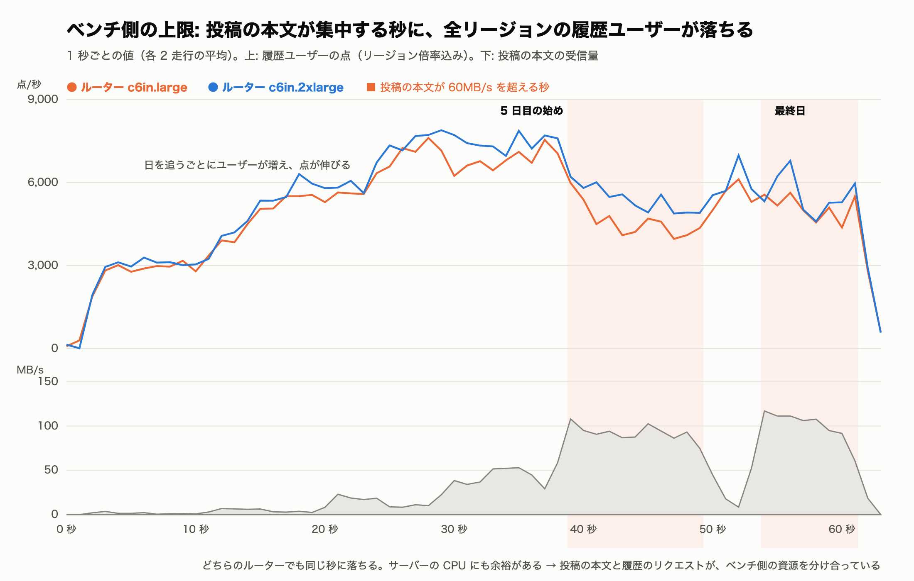

前回の記事「ISUCON2026 で 94 位だったので、人間なしのハーネスを作って感想戦に挑んだ」の続きです。前回の 3 回目の試行は最高 575,333 点でした。そのあと 4 回目の試行を始め、配布された構成のまま（ルーターのスペックは変えずに）**633,287 点** まで伸ばしました。初期実装の 4,127 点から、ベンチは 180 本ほど流しています。

この記事では、どこで点が伸びたのか、どこで伸びなくなったのか、63 万点のときにどういう構成になっていたのかを書きます。

今回も実装と判断はエージェント（Claude Code）が持ちました。ただし 3 回目と違って、僕からも何度か問いを投げています。「65 万を目指して」「サーバーの外が原因でも、こちらからできることはないか」といったものです。どこで効いたかは最後の節で触れます。

## 問題の要点

点の仕組みのうち、作戦に効いたところだけを書きます。

- サーバーは 4 台です。asia1・europe1・america1 がアプリ、asia2 が PostgreSQL として配られます。ユーザーからのリクエストもサーバー間の通信も、すべて **ルーター** を経由します。ルーターがリージョン間の遅延と帯域制限を作っています。
- スコアは「採点された操作の件数 × 配点 × リージョン倍率」の合計です。倍率は asia が 1、europe と america が 1.5 です。
- ベンチの中では「日」が進み、日ごとにユーザーが増えます。投稿期間が始まると、ユーザーは通知を受けて写真を投稿し、友達のフィードを確かめ、閲覧や RealMoji・コメントを一通りこなします。最終日だけは投稿の検証が 20 点（グランプリ）になります。
- これとは別に、**過去の履歴を見続けるユーザー** がいます。Memories（月単位 3 点、日単位 2 点）とエクスポート（1 回 20 点）を繰り返します。

## まずスコアの式を実測で求めた

マニュアルの配点表を眺めているだけでは、どこが伸びしろか分かりませんでした。そこで、走行ごとの access log から操作の種類ごとの件数を数え、スコアに対して回帰をかけました。

```
スコア ≒ 3 × Memories(月) ＋ 2 × Memories(日) ＋ 20 × エクスポート
       ＋ 1.574 × 投稿ユーザーのリクエスト数（リージョン倍率を掛けた数）
```

切片なしで ±5 千点に収まりました。ここから分かったことは 2 つです。

1. **投稿ユーザーの点には上限があります。** 投稿するユーザーの行動は回数で決まっていて、たとえば europe のユーザーは投稿後 約 2.5 秒で約 27 リクエストをこなすと止まります。レスポンスを速くしても増えません。
2. **履歴を見るユーザーは closed-loop で動きます。** レスポンスが返った瞬間に次のリクエストを出すので、速く返すほどサイクルが回り、上限のない項になります。以下、このユーザーを「履歴ユーザー」と呼びます。

なお、履歴ユーザーが取得する過去の画像（1 枚 2 点のはず）の係数はほぼ 0 でした。マニュアルにも「一連の確認に成功した回数を数える」とあり、画像は Memories の確認の一部として数えられているだけでした。

## スコアの推移


*点は 1 本の走行、黒い線はその時点の最高（標準のルーター）。横軸は時刻ではなく走行の順番です*

| スコア | やったこと |
|---:|---|
| 4,127 | 初期実装のまま |
| 19,293 | インデックス、署名のメモ化、ロックの削減、SSE の共有 |
| 59,336 | 画像を DB からファイルへ。read は各リージョンのレプリカから、write は asia へ |
| 121,219 | 画像 URL の署名を、前もって計算したテーブルで引く |
| 171,611 | write 用の DB を asia2 に分離。画像は X-Accel-Redirect で返す。署名の計算を軽くする |
| 224,872 | write を PostgreSQL の関数にして 1 往復にする。エクスポートをストリーミングで返す |
| 260,164 | ユーザー検索をオンメモリに。初期データをユーザー単位で並べ直す |
| 312,300 | asia1 のレプリカをやめ、asia2 から直接 read する |
| **483,855** | **ログイン・ログアウトを受けたサーバーで処理する（1 回で 1.5 倍）** |
| 498,765 | 初期画像の所有者をオンメモリのテーブルで引く |
| 513,082 | 履歴と署名のテーブルをオンメモリに。変更イベントの反映をまとめて行う |
| 546,059 | asia1 での履歴系リクエストの同時実行数を制限 |
| 571,147 | 投稿直前の API で待たせて、投稿のレートを制限 |
| 578,196 | asia の履歴ユーザーを 4 日目から 500 req/s に制限し、倍率 1.5 のリージョンへ処理能力を回す |
| 616,232 | WAL の削減（full_page_writes=off）、write 接続の synchronous_commit=off、TCP 受信ウィンドウの上限、最終日の投稿レートの調整 |
| 622,305 | PostgreSQL ありの版の最高（深夜） |
| **633,287** | **PostgreSQL をなくした版（朝）** |

## 序盤: DB に集中していた処理を散らす

序盤は定石どおりです。

- 画像を DB の bytea からファイルへ移し、sendfile で返しました。
- read は各リージョンの PostgreSQL レプリカから、write は asia2 のプライマリへ送ります。リージョン間の往復が要るのは write だけになります。
- 「write が成功した後の read には結果を反映する（リージョンをまたぐ場合も同じ）」という決まりがあります。そこで、write のレスポンスを返す前に、全レプリカが適用し終えるのを待つようにしました（空のトランザクションを `synchronous_commit = remote_apply` でコミットして待つ）。
- 画像 URL の署名の検証は 1 回 約 1ms と重い処理でした。有効期限を 12 時間刻みにそろえ、前もって計算したテーブルで引くようにしました。

この段階で 30 万点前後です。

## 最大のジャンプ: ログインを受けたサーバーで処理する（31 万 → 48 万）

ベンチのリクエストをキャプチャし、ユーザー（`X-Client-IP`）ごとに並べて読むと、投稿をしないユーザーがいました。このユーザーは次の流れを待ち時間なしで繰り返していました。

```
ログイン → GET /api/memories → 画像 4 枚 → ログイン → …
```

これが履歴ユーザーです。1 サイクル 0.22 秒のほぼ全部がログインでした。ログインはセッションを作る write なので、全レプリカの適用待ちに引っかかり、210ms かかっていたのです。

ログインに配点はありません。セッションはユーザー本人が同じサーバーに続けて使うものです。そこで、**ログインを受けたサーバーのメモリでセッションを発行して即座に返し、asia2 へは 10ms ごとにまとめて送る** ようにしました。他のサーバーは、知らないトークンが来たら少し待ってから判定するので、取りこぼしません。

1 サイクルは 14〜25ms に縮み、スコアは 312,300 から 483,855 になりました。1 回の変更で 1.5 倍です。上限のない項を先に見つけていたから打てた手でした。



## 50 万〜60 万: 履歴ユーザーの邪魔を一つずつ消す

履歴ユーザーが速くなると、今度は履歴ユーザーが触るものが詰まりました。

- **初期画像の所有者の問い合わせ。** ベンチは自分で計算した有効期限で URL を送ってくるので、事前計算した署名と照合できず DB に落ちていました。183 万件の所有者をオンメモリのテーブルに持ちました。
- **履歴のテーブル。** 最初は mmap しましたが、read ロックを持ったままディスクを待ち、全リージョンの write が 10 秒止まって FAIL しました。起動時にメモリへ読み込む形にしました。
- **変更イベントの反映。** asia2 から各サーバーへ write の結果をイベントで流し、各サーバーがオンメモリの read 用データに反映しています。1 件ずつ write ロックを取ると read と取り合うので、受信済みの分（最大 256 件）を 1 回のロックで反映するようにしました。
- **走行中の autovacuum。** 初期化の DELETE で溜まった不要行の掃除が、たまに走行と重なります。そうするとレプリカの適用が遅れ、write の待ちが 10 秒まで伸びて約 6 万点を失います。しきい値を上げて、走行中に走らないようにしました。

## 頭打ちになったら「配分」が効く

ここから全体のリクエスト数が頭打ちになりました。あるリージョンを速くすると、別のリージョンが同じだけ遅くなります。共有の何かが詰まっているということです。

こうなると、速くするよりも **1 リクエストあたりの価値が高いところへ処理能力を回す** 手が効きます。

- asia の履歴ユーザーを 4 日目から 500 req/s に制限しました（超えた分はサーバー側で待たせます）。空いた処理能力は倍率 1.5 の europe・america の履歴ユーザーに回ります。150 では絞りすぎ、1000 では緩すぎでした。
- 投稿の本文（1 件 約 500KB）が一斉に届くと、ルーターからサーバーへのアップロード方向が混み、全員が遅くなります。ユーザーは投稿の直前に必ず `GET /api/posting-window/current` を呼ぶので、そこで待たせて、リージョンごとの投稿レートを決めました（asia 60、europe 65、america 65 件/秒）。

## 60 万の壁の正体: ルーター

ここから先は、何をしても 60 万前後から動かなくなりました。サーバーの CPU は余っていて、履歴ユーザーへのレスポンスはサーバー内で 1ms 未満です。それなのに、レスポンスを返してから次のリクエストが届くまでの間隔が 3ms から 15ms に伸びていました。

測って分かったことは次のとおりです。

- この間隔は、サーバーが返すレスポンスの量で決まっていました。350MB/s 未満なら 3ms、450MB/s 以上だと 15ms です。
- ルーターは c6in.large でした。AWS の公開値で基本帯域が 3.125Gbps（約 390MB/s）、vCPU は 2 個です。**間隔が伸び始める量とちょうど重なります。**
- レスポンスの 53% はエクスポート（1 回 2.3MB の zip）、35% はユーザーが投稿した大きな画像でした。中身は JPEG なので縮みません。
- JSON を gzip で返す手も試しました。レスポンスは 6% 減りましたが、交互に 2 組比べるとスコアは −1.4 万でした。ベンチ側で展開する処理が増えた分、履歴ユーザーが遅くなったと読んでいます。
- PostgreSQL をなくし、全部をオンメモリと追記ログで持つ版も作りました。サーバー間の通信は 7 割減りましたが、交互の比較で差は +0.8k で、ばらつき（標準偏差 10k）の中でした。


*ルーターを上げた走行と並べると、同じレスポンスの量でも待ちが短くなります。ただし 2xlarge でも伸びは残ります*

時間帯の差も大きく出ました。同じ版でも、朝や深夜の空いた時間に流した 1 本は、後で書く補正をした値で 2.4〜3.2 万上振れします。ベンチは他のチームと共有しているので、混み具合が効いていると考えています。

## ルーターを上げずに出した 63 万点の構成



最高の 633,287 点（11/06 朝 8 時の走行）は、PostgreSQL をなくした版で出ました。PostgreSQL ありの版の最高は 622,305 点で、交互に比べた差はばらつきの中です。どちらも、アプリの外側の設定は同じです。

### サーバーの役割

| サーバー | インスタンス | 役割 |
|---|---|---|
| asia1 | c5.large | アプリ（Go が直接 :80 で受ける。nginx は外した）。asia のユーザーと履歴ユーザーを受ける |
| europe1 | c7i.large | アプリ。europe のユーザーを受ける |
| america1 | c7i.large | アプリ。america のユーザーを受ける |
| asia2 | c5.large | write を一手に受けて順番を決めるサーバー |

- read は 3 台のアプリサーバーがそれぞれ自分のメモリだけで返します。初期データの履歴（投稿 63 万件、画像 183 万件の所有者と署名）は、起動時にファイルから読み込みます。
- write は受けたサーバーから asia2 へ転送します。asia2 が順番を決めて適用し、変更イベントを 3 台へ流します。3 台が適用し終えてからレスポンスを返すので、「write の後の read には反映する」という決まりを守れます。
- ログイン・ログアウトだけは、受けたサーバーで処理します（上の 48 万の節）。

### PostgreSQL をなくした版の中身

- asia2 で Go のプロセスが write を受け、メモリに適用し、追記ログに書いて fsync します。
- アプリサーバーと asia2 の間は TCP 1 本で、転送・レスポンス・変更イベント・適用の確認を 4ms ごとにまとめて送ります。サーバー間のパケット数は、write の件数に関係なく一定の上限に収まります。
- レスポンスは「全アプリサーバーが適用し、かつ追記ログを fsync した後」に返します。リージョン間の往復のあいだに fsync は終わるので、遅くはなりません。
- 再起動すると、asia2 は初期データのスナップショットに追記ログを再生して状態を戻します。アプリサーバーは asia2 につなぎ直して続きを受け取ります。
- PostgreSQL ありの版と同じリクエスト列を流して、558 手順で応答の差がゼロであることを確かめてから使いました。

PostgreSQL ありの版では、asia2 の PostgreSQL をプライマリ、europe1 と america1 を同期レプリカにしていました。設定は full_page_writes=off、write 接続の synchronous_commit=off、autovacuum のしきい値の引き上げです。

### アプリサーバー側の主な設定

| 設定 | 値 | ねらい |
|---|---|---|
| 投稿レート（`posting-window/current` で待たせる） | asia 60、europe・america 65 件/秒 | アップロードの集中で全員が遅くなるのを防ぐ。倍率 1.5 の地域を厚く |
| 5 日目の始めの asia の投稿レート | 最初の 3 秒 170、次の 3 秒 110 件/秒 | 他リージョンの投稿期間が始まる前の空き帯域を使う |
| 最終日の asia の投稿レート | 6.5 秒まで 75、8.3 秒まで 115、最後 15 件/秒 | europe・america の投稿が終わった後半の空きを使う |
| asia の履歴ユーザーの上限 | 4 日目から 500 req/s、同時 6 | 処理能力を倍率 1.5 の地域へ回す |
| TCP 受信ウィンドウの上限 | 32KB | アップロードでルーターの中の列が伸びすぎないようにする |
| GOGC / GOMEMLIMIT | 400 / 1150MiB（asia1） | 2GB メモリで GC を減らす |
| ビルド | PGO、GOAMD64=v3 | 効果は 2% 以下。損はないので入れたまま |

### このときのスコアの内訳

- 5 日目のユーザー数は asia 1,255、europe 564、america 438 人でした。グランプリは asia 679、europe 530、america 435 人です。
- 履歴ユーザーの点（3×Memories(月) ＋ 2×Memories(日) ＋ 20×エクスポート、倍率込み）は 31.3 万点で、残り約 32 万点が投稿ユーザーの点です。
- サーバーが返したレスポンスは約 21GB で、うちエクスポートが 51%、画像が 44% でした。
- CPU の平均使用率は asia1 34%、europe1・america1 15% 前後、asia2 15%（ほぼ fsync の待ち）でした。サーバーには余力がありました。

最終日の asia では、約 1,250 人のうち 679 人しかグランプリを取れていません。投稿の本文を速く受けると、アップロードの混雑で履歴ユーザー全体が遅くなり、差し引きで損になるからです。ここが c6in.large のルーターでの天井でした。

## 比べ方の工夫

60 万を超えると、施策の効果がばらつきより小さくなりました。そこで比べ方を決めました。

- **1 本のスコアで決めない。** 5 日目のユーザー数（倍率込み）を説明変数にスコアを回帰し、実測との差（残差）で比べました。スコアのばらつきの大半は、ユーザー数の運でした。
- **同じ時間帯に交互に流す。** ベンチの混み具合で残差が数万動くからです。
- **スコアではなく狙った項を見る。** 履歴ユーザーの点を access log から毎回計算し、6 秒ごとに並べて、どの時間帯で何を失ったかを見ました。

## おまけ: ルーターを上げると 65 万

運営から「60〜65 万が見えたチームはルーターが詰まりだすので、スペックを上げると次が開ける」と聞き、許可を得てルーターを c6in.2xlarge に上げて流しました（環境チェックは通らない構成です）。

- 同じ版のまま 644,659 点になり、履歴ユーザーの点が +8% 増えました。最高は **651,965 点** です。
- 4xlarge にしてもスコアは変わりませんでした。ルーターの CPU も帯域も余っていて、その先の上限はベンチ側です。
- 2xlarge では、投稿の本文が約 100MB/s を超える数秒だけ、全リージョンの履歴ユーザーが一斉に落ちます。投稿の本文も履歴のリクエストもベンチが送るので、ベンチのネットワークか CPU を分け合っていると読んでいます。


*4 日目までの差がルーターを上げた効果です。投稿が集中する秒の落ち込みはどちらにもあり、ここがベンチ側の上限です*

## 試してダメだったこと

| 手 | 結果 |
|---|---|
| 投稿の本文を同時に受け取る数を絞る | 待っている接続が受信バッファを埋めて再送が増え、FAIL |
| 通知を少しずつ送ってアップロードをならす | 通知が遅れたユーザーは翌日の増加に数えられず、ユーザー数が伸びない |
| 履歴のテーブルを mmap | read ロック中のディスク待ちで全体が止まり、FAIL |
| レスポンスをバッファして Content-Length を付ける | GC が増えて 48〜50 万点に落ちた |
| 受け取った画像を中身のハッシュで重複排除 | 画像の種類が想定より多く、当たらない |
| BBR、PGO、GOAMD64=v3 | 1 リクエストの CPU は 2% 以下しか変わらず、頭打ちの下ではスコアに出ない |
| JSON の gzip | ベンチの処理が増えて −1.4 万 |
| PostgreSQL なし | ばらつきの中（+0.8k） |

投稿の本文を最後まで受け取らずにレスポンスして、アップロードの帯域を空ける案も出ました。ただ、これは「帯域制限の回避」や「ベンチだけを識別して異なる結果を返す」に当たると判断し、試していません。

## AI エージェントで回したこと

メインのエージェント 1 本が、計測、仮説、実装、デプロイ、ベンチ、記録までを持ちました。調べものは必要に応じて別のエージェントに切り出しました。続けられたのは、次の仕組みのおかげです。

- **作戦ボード** に「今のスコア、スコアの式の各項、今のボトルネック、次の 1 手」を集め、ベンチのたびに更新させました。コンテキストが切れても、ここから再開できます。
- **判断の記録** は「見たもの → 考え → 決めたこと」の 3 段で書かせ、「何が変わったら考え直すか」を必ず添えさせました。「この判断の根拠は？」と聞けば、ファイルの行やジョブ番号が返ってきます。
- **1 コミット 1 改善**、環境変数フラグの台帳、永続性を弱める設定の事前記録で、何が効いたか分からないデプロイを防ぎました。
- 僕がやったのは方向の確認です。「65 万を取っている人がいる」「サーバーの外が原因でも、こちらからできることがあるのでは」と問いを投げると、前提を考え直すきっかけになりました。この記事の下書きも Claude Code が書いています。

## まとめ

- スコアの式を実測で求めて、**上限のない項（closed-loop の履歴ユーザー）** を見つけたのが最大の転機でした。ログインを受けたサーバーで処理するようにして 1.5 倍になりました。
- 頭打ちになったら、速くするより **価値の高いところへ処理能力を配る** 手が効きます。
- c6in.large での 60 万の壁は、こちらのサーバーではなく **ルーター** でした。ルーターを上げた先の上限は **ベンチ** です。
- 60 万を超えると、ばらつきと時間帯が施策の効果より大きくなります。比べ方の設計が一番大事でした。
